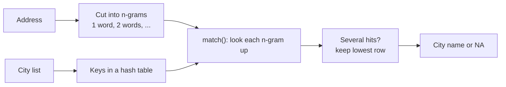

# City matching with n-gram lookup

How CleanMatch finds the city in a name or address since October 2026. Used by `harmonize_cities()` and
`detect_address()`; the code is in `R/city_lookup.R` (`city_lookup()` and `city_match()`).

> [!summary] In one sentence
> Cut each address into all runs of neighbouring words, look every run up in a hash table of city names,
> and keep the hit that comes first in the city list.
> Short description for method documentation: *word n-gram lookup against a gazetteer, ties resolved by list order*.

## The task

Find which city of the `cities` list appears in a string such as `RUE DE LA GARE ESCH SUR ALZETTE`.
Each city pattern has the form `(^| )NAME( |$)`: NAME must appear as whole words, next to each other,
in the same order. The list is sorted official names first, then longer names first; the first pattern
that matches wins.

## Old method: go through the whole list

For each city in the list (591 for LU, 41,031 for DE), run a regex over every row.
Like reading a whole letter once for every name in your address book.
The time grows with (number of cities) × (number of rows).

## New method: cut the address into pieces and look each piece up

1. **Build the lookup table** (`city_lookup()`): strip `(^| )` and `( |$)` from each pattern, so
   `(^| )ESCH SUR ALZETTE( |$)` becomes the key `ESCH SUR ALZETTE`. Each key remembers its row in the list.
2. **Cut each address into n-grams** (`city_match()`): every run of 1, 2, 3, … neighbouring words.
3. **Look every n-gram up** in the table with `match()`, which uses a hash table.
4. **Choose per address**: when several n-grams are cities, keep the one with the lowest row in the list.
   This is the one the old loop found first, so both methods give the same answer.

### Example

Address: `RUE DE LA GARE ESCH SUR ALZETTE` (7 words)

| Round | n-grams | Hit |
|---|---|---|
| 1 | RUE · DE · LA · GARE · ESCH · SUR · ALZETTE | none |
| 2 | RUE DE · DE LA · LA GARE · GARE ESCH · ESCH SUR · SUR ALZETTE | none |
| 3 | RUE DE LA · DE LA GARE · LA GARE ESCH · GARE ESCH SUR · **ESCH SUR ALZETTE** | row 5 |
| 4 to 7 | longer runs | none |
| 8 | no 8-word runs in a 7-word address | stop |

Result: ESCH SUR ALZETTE.

### Tie rule in action

`VILLE DE LUXEMBOURG` contains two keys: `LUXEMBOURG` (row 42, official name) and
`VILLE DE LUXEMBOURG` (row 163, alternate name). Row 42 wins. Both point to LUXEMBOURG here, but if
they pointed to different cities, the official name would win, as in the old loop.

### How many rounds?

A matching n-gram has exactly as many words as the key it equals, so n-grams longer than the longest
key can never match. The loop stops:

- after the length of the longest key (12 words for LU, 14 at most across all countries), or
- earlier, when no address has that many words.

Each round is **one** `match()` call over the n-grams of **all** addresses at once.

| Words in key (LU) | 1 | 2 | 3 | 4 | 5 | 8 | 9 | 12 |
|---|---|---|---|---|---|---|---|---|
| Number of keys | 457 | 66 | 47 | 11 | 3 | 2 | 1 | 1 |

The 12-word key is an alternate name of Echternach:
`ECHTERNACH CHEF LIEU DE DISTRICT ET SIEGE DU COMMANDEMENT DES TROUPES LUXEMBOURGEOISES`.

## How the hash table works

> [!tip] Picture
> A cabinet of numbered drawers. A fixed rule (the **hash function**) turns a name into a drawer number.

### Storing the city names

Apply the rule to each name and put the name in that drawer. Each drawer holds **at most one name**.
If the drawer is taken, use the next free drawer.

### The hash is the same every time, but not unique

The same name always gives the same number. Different names can give the same number (a **collision**),
because there are far more possible texts than drawers (like 400 people and 365 birthdays).
The number only says *where to look*; the final decision is a comparison of the texts.

### Toy example

Rule: drawer = number of characters, keep the last digit (10 drawers, 0 to 9).

| Name | Characters | Drawer by rule | Ends up in |
|---|---|---|---|
| LUXEMBOURG | 10 | 0 | 0 |
| ETTELBRUCK | 10 | 0 (taken) | 1 |
| ESCH SUR ALZETTE | 16 | 6 | 6 |
| DIEKIRCH | 8 | 8 | 8 |

Looking up:

- `ETTELBRUCK` → drawer 0 holds LUXEMBOURG, a different name → drawer 1 holds ETTELBRUCK → **found**.
- `GARE ESCH` (9) → drawer 9 is empty → **not a city**.
- `MERSCH GARE` (11) → drawer 1 holds ETTELBRUCK, a different name → drawer 2 is empty → **not a city**.

### How the lookup finds a name that moved to another drawer

Nothing records where ETTELBRUCK ended up. The lookup **repeats the steps used for storing**: start at
the drawer the rule gives, step forward until the name or an empty drawer. A stored name can never lie
beyond an empty drawer on its path, because it went into the first free drawer when it was stored.
Like parking: always try space 12, else the next free one; to find your car, start at 12 and walk on.

This works because the rule never changes and `match()` never removes names from its table.

### What R does

- `match(gram[ok], lk$key)` builds the table from `lk$key` (the city names), then looks up each n-gram.
- Number of drawers: twice the number of names, rounded up to a power of 2. About two drawers in three
  stay empty, so most lookups end after one drawer, sometimes two.

| Country | Keys | Drawers | In use |
|---|---|---|---|
| LU | 588 | 2,048 | 29% |
| DE | 40,627 | 131,072 | 31% |

- R stores each distinct text once in memory, so `match()` compares memory addresses instead of letters.
- The table is rebuilt in each round (up to 14 times); for 40,627 names this takes about a millisecond.
  `fastmatch::fmatch()` could keep it, but is not worth an extra dependency.

## Why it is fast

| | Old loop | New lookup |
|---|---|---|
| Work per row | one regex per city of the country | a few dozen n-gram lookups |
| Depends on size of city list | directly | hardly at all |
| DE, 1,000 rows | 45.7 s | 0.26 s |
| DE, 4,000 rows | 168.5 s | 0.65 s |
| DE, 1 million rows (98k distinct) | about 12 h (estimated) | 8.2 s |

`harmonize_cities()` also cleans and looks up each **distinct** string only once, then maps the result
back to the rows with `match()`.

## Details that keep the output identical to the old loop

- **Duplicate keys**: when the same key appears on several rows, only the first row is kept.
- **Regex classes in keys**: 94 patterns end in a class such as `[A ]` or `[IPA]`; `city_lookup()` writes
  one key per letter (`FOO [IPA]` → `FOO I`, `FOO P`, `FOO A`).
- **Spaces**: in `detect_address()`, double or edge spaces give empty words, which never equal a key,
  just as the regex would not match across them.
- **No match**: `city_match()` returns `NA`; `harmonize_cities()` then keeps the cleaned name.
- **Checked by tests**: `tests/testthat/` compares the output with the saved output of version 0.1.0.

## Names for the parts

- **Word n-grams** (also *shingles*): runs of neighbouring words.
- **Gazetteer lookup** / **dictionary matching**: finding entries of a list of names in text.
- **Hash table** with **open addressing** (*linear probing*): the drawers, one name per drawer, next
  free drawer on a collision.
- **Aho–Corasick** (1975): the classic algorithm for finding all dictionary entries in a text in one
  pass, using a tree of characters. Our method is a simpler, word-based relative that suits R's
  vectorised `match()`.
- The tie rule (list order) is not a standard named rule; many tools use *leftmost-longest match* instead.

## Known limits

- Matching is exact: a misspelt city (`LUXEMBURGG`) is not found. Fuzzy matching would be a separate step.
- The city list has keys that point to several cities (2,272 within a country); the first row wins
  silently. See [[bug_log|CleanMatch bug log]].
